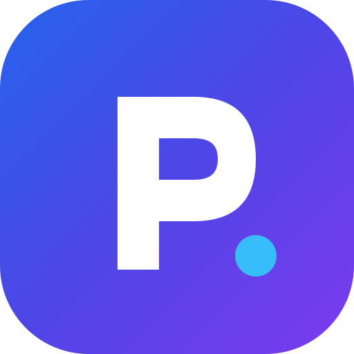

# 🎓 PlacePrep — College-Aware Placement Preparation Platform

<p align="center">
  
</p>

<p align="center">
  <strong>Prepare Smarter. Get Placed.</strong><br>
  A unified, modern, responsive EdTech SaaS web application for engineering students and campus placement preparation.
</p>

<p align="center">
  
  
  
  
  
  
</p>

---

## 📌 About PlacePrep

Students preparing for campus placements often shuffle between multiple fragmented platforms for aptitude quizzes, coding practice, core technical MCQs, mock interviews, and company blueprints. This makes preparation inconsistent and tracking overall progress difficult.

**PlacePrep** solves this with **College-Aware Personalized Placement Intelligence**:
It integrates a student's academic background, college recruitment history, individual strengths and weaknesses, target companies, and daily preparation availability into an **actionable, personalized preparation roadmap**.

---

## ✨ Key Features

### 🏛️ 1. College Profile & Placement Intelligence (`/college-intelligence`)
- **Historical Recruiter Records**: Track visiting companies by academic year, recruitment tiers (*Dream, Super Dream, Core IT, Mass/Services*), salary packages (LPA), offers count, and eligibility criteria (minimum CGPA & backlogs).
- **Branch-Wise Statistics**: Historical placement percentage and statistics across departments (CSE, IT, ECE, Mechanical, etc.).
- **TPO Management & CSV Export**: Interactive portal for Training & Placement Officers (TPOs) to add, edit, and verify institutional recruiter records, with one-click CSV export.
- **Transparency Badges**: Clear visual tags distinguishing verified institutional records from demo/sample datasets.

### 🎯 2. Personalized Roadmap Engine (`/learning-path`)
- **Algorithmic Roadmap Generation**: Generates daily and weekly tasks factoring in target companies, confirmed college recruiters, assessed skill gaps, and remaining preparation time.
- **Dynamic Study Availability**: Adjust daily study time (60 min, 90 min, 120 min, 180 min) to automatically balance workload.
- **Task Actions**: Mark tasks complete, postpone tasks, or regenerate the roadmap on demand.

### 🏢 3. Target Company Matcher (`/companies`)
- **Multi-Company Selection**: Target multiple companies simultaneously.
- **Transparent Match Score (0–100%)**:
  - **Academic Eligibility Check**: Real-time evaluation of student CGPA and backlog criteria.
  - **Skills Match**: Compares company requirements against student assessed skill levels.
  - **College Recruitment Status**: Distinguishes between confirmed on-campus recruiters, past recruiters, and off-campus targets.
- **Company Preparation Checklists**: Dedicated round-by-round checklists for tier-1 tech giants and mass recruiters.

### 📊 4. Student Strength & Weakness Analyzer (`/progress`)
- **Granular 13-Topic Performance Breakdown**: Diagnostic accuracy across Aptitude (Quantitative, Logical, Verbal, DI), Coding (Arrays & Strings, Trees & Graphs, DP), and Core Technical CS subjects (DBMS, OS, CN, OOP).
- **Categorization & Remediation**: Automatically identifies strengths ($\ge 75\%$), moderate areas ($55\%-74\%$), and critical bottlenecks ($< 55\%$) with direct practice remediation links.

### 💡 5. Comprehensive Practice Modules
- **Aptitude & Reasoning (`/aptitude`)**: Timed practice drills, question palette, and detailed rationales.
- **Coding IDE Sandbox (`/coding`)**: In-browser compiler simulator supporting Python, C++, Java, and JavaScript with testcase drawer.
- **Core CS Technical MCQs (`/technical`)**: Quizzes on OS, DBMS, Computer Networks, and OOP.
- **AI Mock Interview Simulator (`/interview`)**: Behavioral, Technical, and HR interviews with response evaluation, voice toggle, hints, and rubric scoring.
- **ATS Resume Builder (`/resume`)**: Real-time side-by-side preview, modular section editors, LocalStorage draft saving, and PDF print export.
- **Placement Cell Dashboard (`/admin`)**: Institutional overview, student ranking table, recruiter management, and campus broadcast announcements.

---

## 🌐 Progressive Web App (PWA)

- **PWA Support**: Configured with `manifest.json` and a custom Service Worker (`sw.js`) for asset caching and improved load performance.
- **Local Persistence**: Test attempts, target companies, personalized roadmap tasks, and profile details persist in `localStorage`.
- **Live Status Indicator**: Visual indicator in the top navbar shows real-time **"Online"** or **"Offline Mode"** connectivity status.
- **Local AI Engine**: Generates interview evaluations, skill gaps, and roadmap tasks on-device using built-in heuristics — no external cloud API keys required.

---

## 🛠️ Tech Stack

- **Framework**: Next.js 14 (App Router)
- **Library**: React 18
- **Language**: TypeScript
- **Styling**: Tailwind CSS
- **Design Tokens**:
  - Background: `#F7F9FC`
  - Cards & Borders: `#FFFFFF` / `#E3EAF5`
  - Primary Accent: `#315BFA` (Hover: `#2548DE`)
  - Typography: `#142748` (Headings) / `#52627A` (Body)
  - AI Assistant Tone: Soft Violet `#F1EDFF`
- **Icons**: Lucide React
- **Architecture**: Modular Component Architecture, LocalStorage Persistence, Service Worker Caching

---

## 🚀 Quick Start Guide

### Prerequisites
- **Node.js**: `18.x`, `20.x`, `22.x`, or LTS
- **npm**: `9.x` or higher
- **Git**

### Installation

1. **Clone the repository:**
   ```bash
   git clone https://github.com/Sudarshan77-tech/PlacePrep-standalone.git
   cd PlacePrep-standalone
   ```

2. **Install dependencies:**
   ```bash
   npm install
   ```

3. **Start the development server:**
   ```bash
   npm run dev
   ```

4. **Open in browser:**
   Navigate to [http://localhost:3000](http://localhost:3000)

---

## ⚡ Production Build

To test the optimized production build locally:

```bash
# Build the production bundle
npm run build

# Start the production server
npm start
```

---

## 📂 Project Structure

```
PlacePrep/
├── public/                     # Static assets & PWA configuration
│   ├── icons/                  # PWA icons
│   ├── manifest.json           # Web App Manifest
│   └── sw.js                   # Service worker for offline caching
├── src/
│   ├── app/                    # Next.js App Router pages
│   │   ├── page.tsx            # Landing Page
│   │   ├── dashboard/          # Student Dashboard
│   │   ├── college-intelligence/ # College Placement Intelligence & TPO Hub
│   │   ├── learning-path/      # Personalized Daily/Weekly Roadmap
│   │   ├── companies/          # Target Company Matcher & Checklists
│   │   ├── progress/           # Strength & Weakness Analyzer
│   │   ├── aptitude/           # Aptitude Practice Engine
│   │   ├── coding/             # Coding IDE & Sandbox
│   │   ├── technical/          # Technical CS MCQs
│   │   ├── interview/          # Mock Interview Simulator
│   │   ├── resume/             # ATS Resume Builder
│   │   ├── profile/            # Student Academic Profile
│   │   ├── settings/           # Settings & Data Reset
│   │   └── admin/              # Placement Cell / TPO Admin
│   ├── components/layout/      # Sidebar, Navbar, and DashboardLayout
│   ├── context/                # PlacePrepContext (State & LocalStorage)
│   ├── data/                   # Realistic Mock Data & Recruiter History
│   ├── services/               # Roadmap Engine & Local AI Evaluator
│   └── types/                  # TypeScript Data Contracts
├── package.json
├── tailwind.config.ts
├── tsconfig.json
└── README.md
```

---

## 📄 License

This project is licensed under the [MIT License](LICENSE).
